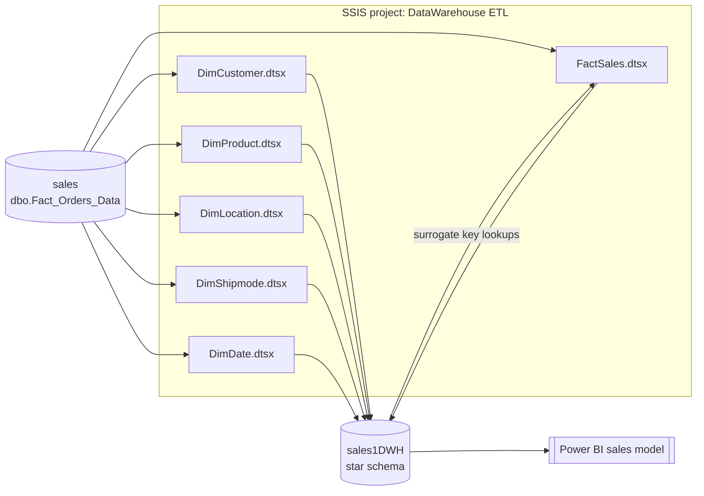
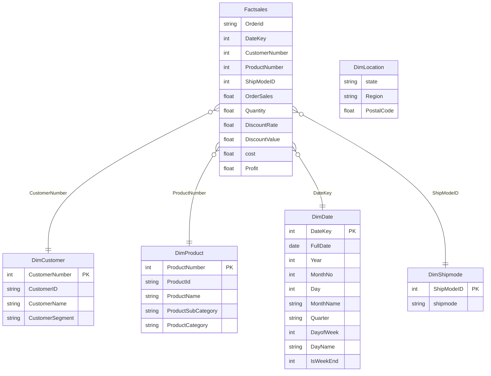

# DataWarehouse ETL

An end-to-end **SQL Server Integration Services (SSIS)** project that turns a flat sales/orders table into a **star-schema data warehouse**, which is then used as the source for a **Power BI** sales report.

The project shows the classic BI workflow:

1. **Extract** raw order lines from an operational/staging database.
2. **Transform** them into clean, de-duplicated dimensions and a fact table with surrogate keys and calculated measures.
3. **Load** the result into a dedicated data warehouse database that Power BI models and reports on.

---

## Architecture



| Layer          | Database / tool | Contents |
|----------------|-----------------|----------|
| Source         | `sales`         | One wide table, `dbo.Fact_Orders_Data`, with one row per order line |
| ETL            | SSIS (this repo) | 6 packages: 5 dimensions + 1 fact |
| Data warehouse | `sales1DWH`     | `DimCustomer`, `DimProduct`, `DimLocation`, `DimShipmode`, `DimDate`, `Factsales` |
| Reporting      | Power BI        | Sales model built on the warehouse tables |

Both connections use the OLE DB provider (`MSOLEDBSQL`) with **Windows Integrated Security**, so no usernames or passwords are stored in the project.

---

## Source data

`dbo.Fact_Orders_Data` in the `sales` database is a denormalised order-lines table. Its columns:

| Group     | Columns |
|-----------|---------|
| Order     | Order ID, Year, Month, Week number, Order Date, Ship Date, Ship Mode |
| Customer  | Customer ID, Customer Name, Client Segment |
| Location  | Country, State, Postal Code, Region |
| Product   | Product ID, Product Category, Sub-Category, Product Name |
| Measures  | Sales Price, Quantity, Discount, Total Sales Amount, Purchasing Price, Total Purchasing Amounts, Net Profit |

Because customer, product, location and shipping attributes repeat on every order line, the table is split into dimensions and a fact table to cut out that repetition and make reporting faster and simpler.

---

## Data warehouse model (star schema)



The surrogate keys (`CustomerNumber`, `ProductNumber`, `ShipModeID`) are generated by the warehouse tables (identity columns), not by SSIS. `DateKey` is a "smart key" in `YYYYMMDD` format built in the `DimDate` package.

---

## Packages in detail

Every package has a single **Data Flow Task**: an **OLE DB Source** reading `dbo.Fact_Orders_Data`, transformations, and an **OLE DB Destination** using fast load (`TABLOCK`, `CHECK_CONSTRAINTS`).

### `DimCustomer.dtsx` → `dbo.DimCustomer`

- Reads `Customer ID`, `Customer Name`, `Client Segment`.
- **Sort** on `Customer ID` with *remove duplicates*, so each customer appears once.
- Maps to `CustomerID`, `CustomerName`, `CustomerSegment`. `CustomerNumber` is the surrogate key.

### `DimProduct.dtsx` → `dbo.DimProduct`

- Reads `Product ID`, `Product Name`, `Sub-Category`, `Product Category`.
- **Sort** on `Product ID` with *remove duplicates*.
- Maps to `ProductId`, `ProductName`, `ProductSubCategory`, `ProductCategory`. `ProductNumber` is the surrogate key.

### `DimLocation.dtsx` → `dbo.DimLocation`

- Reads `Country`, `State`, `Postal Code`, `Region`.
- **Sort** on Country → State → Postal Code → Region with *remove duplicates*, giving one row per unique location.
- Loads `state`, `Region`, `PostalCode`.

### `DimShipmode.dtsx` → `dbo.DimShipmode`

- Reads `Ship Mode`, **Sort** with *remove duplicates*.
- Loads `shipmode`. `ShipModeID` is the surrogate key.

### `DimDate.dtsx` → `dbo.DimDate`

Builds a calendar dimension from the distinct order dates (**Sort** on `Order Date` with *remove duplicates*), then a **Derived Column** adds the calendar attributes:

| Column      | Expression (SSIS) | Example |
|-------------|-------------------|---------|
| `DateKey`   | `(DT_I4)(YEAR(d) * 10000 + MONTH(d) * 100 + DAY(d))` | `20240315` |
| `FullDate`  | `[Order Date]` | 2024-03-15 |
| `Year`      | `YEAR(d)` | 2024 |
| `MonthNo`   | `MONTH(d)` | 3 |
| `Day`       | `DAY(d)` | 15 |
| `MonthName` | nested conditional on `MONTH(d)` | March |
| `Quarter`   | `MONTH(d) <= 3 ? "Q1" : … : "Q4"` | Q1 |
| `DayofWeek` | `DATEPART("dw", d)` (1 = Sunday) | 6 |
| `DayName`   | nested conditional on `DATEPART("weekday", d)` | Friday |
| `IsWeekEnd` | `DATEPART("dw", d)` is 6 or 7 → `1`, else `0` | 1 |

> `IsWeekEnd` treats **Friday and Saturday** as the weekend, as in Saudi Arabia and much of the Middle East.

### `FactSales.dtsx` → `dbo.Factsales`

The fact package reads every order line and swaps the descriptive values for warehouse keys:

1. **Data Conversion**: casts `Order Date` to a date (`DT_DBDATE`) so it matches `DimDate.FullDate`, and converts `Order ID` / `Ship Mode` to the destination data types.
2. **Lookups** (one per dimension):

   | Lookup        | Join column                       | Returns          |
   |---------------|-----------------------------------|------------------|
   | `DimCustomer` | `Customer Name` = `CustomerName`  | `CustomerNumber` |
   | `DimProduct`  | `Product Name` = `ProductName`    | `ProductNumber`  |
   | `DimDate`     | `Order Date` = `FullDate`         | `DateKey`        |
   | `DimShipmode` | `Ship Mode` = `shipmode`          | `ShipModeID`     |
   | Location      | `State` = `State` (against the source table) | match check only |

3. **Derived Column**: calculates the extra measures:
   - `DiscountValue = [Total Sales Amount] * Discount`
   - `cost = [Total Sales Amount] - Discount * [Total Sales Amount] * [Net Profit]`
4. **OLE DB Destination**: loads the fact table:

   | Source column        | Fact column      |
   |----------------------|------------------|
   | Order ID             | `Orderid`        |
   | DateKey (lookup)     | `DateKey`        |
   | CustomerNumber       | `CustomerNumber` |
   | ProductNumber        | `ProductNumber`  |
   | ShipModeID           | `ShipModeID`     |
   | Sales Price          | `OrderSales`     |
   | Quantity             | `Quantity`       |
   | Discount             | `DiscountRate`   |
   | DiscountValue        | `DiscountValue`  |
   | cost                 | `cost`           |
   | Net Profit           | `Profit`         |

---

## Execution order

The fact package relies on the dimensions already being loaded, because its lookups need their surrogate keys:

```
DimCustomer ─┐
DimProduct  ─┤
DimLocation ─┼──►  FactSales
DimShipmode ─┤
DimDate     ─┘
```

The five dimension packages don't depend on each other and can run in parallel.

---

## Power BI model

The `sales1DWH` warehouse is the data source for a Power BI sales report. The fact table relates to each dimension on its surrogate key (one-to-many, single direction), and `DimDate` serves as the report's calendar table for time-based analysis (year / quarter / month / weekday slicing, weekend vs weekday sales, and so on).

---

## Repository structure

```
DataWarehouse ETL.sln                 Visual Studio solution
DataWarehouse ETL/
├── DataWarehouse ETL.dtproj          SSIS project file (deployment model, package list)
├── Project.params                    Project parameters (none defined)
├── Hassan-PC.sales.conmgr            Project-level connection manager to the source DB
├── DimCustomer.dtsx                  Customer dimension
├── DimProduct.dtsx                   Product dimension
├── DimLocation.dtsx                  Location dimension
├── DimShipmode.dtsx                  Ship mode dimension
├── DimDate.dtsx                      Date / calendar dimension
└── FactSales.dtsx                    Sales fact table
```

Build output (`bin/`, `obj/`, `.ispac`) and Visual Studio user files are excluded by `.gitignore`.

---

## Getting started

### Requirements

- Visual Studio 2022 with the **SQL Server Integration Services Projects** extension
- SQL Server (Developer or Express edition is fine) with:
  - a `sales` database holding `dbo.Fact_Orders_Data`
  - a `sales1DWH` database with the dimension and fact tables already created (identity columns for the surrogate keys)
- Power BI Desktop (for the report)

### Running the ETL

1. Clone the repo and open `DataWarehouse ETL.sln` in Visual Studio.
2. Update the connection managers to point at your SQL Server instance. The project uses `Hassan-PC`, the original development machine.
3. Run the five `Dim*.dtsx` packages, then `FactSales.dtsx`.
4. Or build the project and deploy `bin/Development/DataWarehouse ETL.ispac` to the SSIS catalog (`SSISDB`) and schedule it with SQL Server Agent.
5. Open Power BI and connect to `sales1DWH`.

---

## Design notes and possible improvements

This is a learning / portfolio project. Some things that could be improved in a production version:

- **Full reload only.** The packages insert every time they run, with no truncate step or incremental logic. Re-running them adds duplicate rows. A next step would be an *Execute SQL Task* that truncates the tables first, or an incremental (upsert / SCD) load.
- **Look up by business key.** The fact lookups join on `Customer Name` and `Product Name`. Joining on `Customer ID` and `Product ID` would be safer, since two customers or products can share a name.
- **Location key in the fact table.** `DimLocation` has no surrogate key, and the location lookup in `FactSales` checks against the source table rather than `DimLocation`. So the fact table can't be sliced by location yet. Adding a `LocationKey` to both tables would complete the star.
- **Orchestration.** A master package with *Execute Package Tasks* could run all dimensions in parallel and then the fact table, in a single execution.
- **Configurable connections.** Moving the server and database names into project parameters or SSIS catalog environments would let the same packages run on dev, test and prod without being edited.
- **Lookup no-match handling.** The lookups use the default *Fail component* setting, so a single order line with no matching dimension row stops the whole load. Sending unmatched rows to a no-match output, or mapping them to an "Unknown" dimension member, would make the load more robust.
- **Data types.** Several measures come from the source as `float` (`DT_R8`). `decimal` / `money` would be more accurate for currency values.
